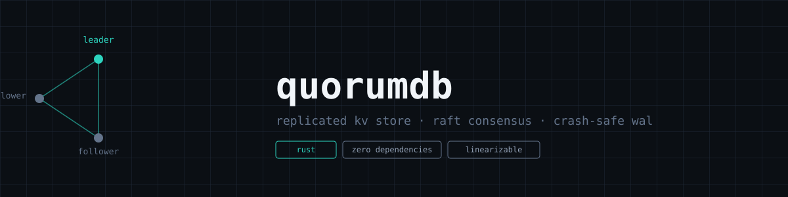

# quorumdb

Embeddable replicated key-value store with Raft consensus and a crash-safe
write-ahead log. Linearizable reads and writes, zero external dependencies.

## Status

Early scaffold — core types and message shapes are in place, the event loop
and real network transport are not wired up yet. See `TODO`s in `src/`.

## Layout

- `src/raft.rs` — leader election, log replication, cluster membership
- `src/storage.rs` — write-ahead log + key-value state machine
- `src/network.rs` — RPC transport between nodes
- `src/main.rs` — node entrypoint
- `tests/chaos.rs` — partition / crash simulation, linearizability checks

## Building

```
cargo build
cargo test
```

## License

MIT — see LICENSE.
