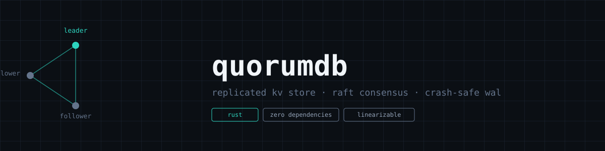

# quorumdb

In-process **3-node Raft** key-value store. Pure Rust. Zero external dependencies.

Leader election, log replication, majority commit, and an optional durable WAL with full replay.

## What it is

- Fixed 3-node cluster running inside one process
- Raft: RequestVote + AppendEntries, term safety, log matching
- In-memory state machine (`Put` / `Delete`)
- Optional on-disk WAL: append + `read_all` + `truncate_from`
- No TCP — the network is replaced by direct method calls

## Quick start

```rust
use quorumdb::cluster::Cluster;

let mut cluster = Cluster::new();
assert!(cluster.elect(1));
cluster.put(1, "alpha", b"one").unwrap();
assert_eq!(cluster.get(2, "alpha").unwrap(), b"one");
assert_eq!(cluster.leader_id(), Some(1));
```

## WAL

```rust
use quorumdb::storage::Wal;
use quorumdb::raft::LogEntry;

let mut wal = Wal::open("log.dat")?;
wal.append(&LogEntry { term: 1, index: 1, command: b"cmd".to_vec() })?;
let entries = Wal::read_all("log.dat")?;
Wal::truncate_from("log.dat", 1)?;
```

## Build

```sh
cargo test
cargo run
```

## License

MIT
